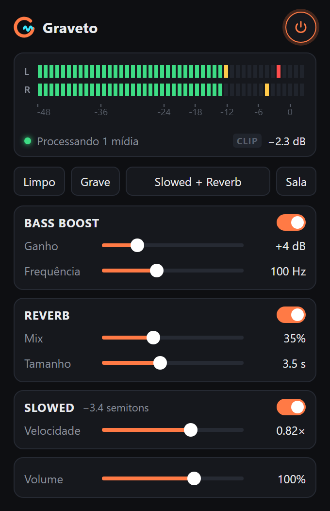
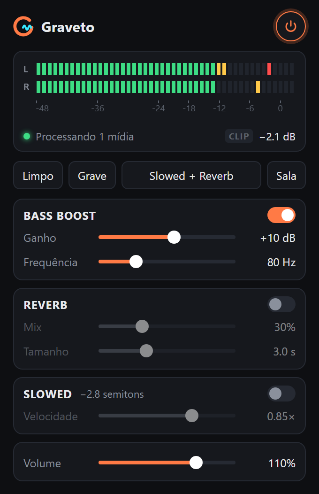

<p align="center">
  
</p>

Extensão do Chrome (Manifest V3) que processa o áudio de qualquer `<audio>`/`<video>` da página:

- **VU meter** estéreo — RMS com balística, pico segurado e indicador de CLIP
- **Bass Boost** — lowshelf ajustável (0–18 dB, 40–200 Hz) com limiter para não distorcer
- **Reverb** — convolução com impulso sintético (mix e tamanho da sala 0,5–8 s)
- **Slowed** — reduz velocidade e tom juntos (0,50–1,00×), como nos edits "slowed + reverb"

<table>
  <tr>
    <td align="center"></td>
    <td align="center"></td>
  </tr>
  <tr>
    <td align="center">Preset <b>Slowed + Reverb</b></td>
    <td align="center"><b>Bass Boost</b> a +10 dB</td>
  </tr>
</table>

## Instalar

1. Abra `chrome://extensions`
2. Ative o **Modo do desenvolvedor**
3. **Carregar sem compactação** → selecione esta pasta

## Publicar na Chrome Web Store

```bash
node scripts/package.mjs        # gera dist/graveto-<versão>.zip
node scripts/store-assets.mjs   # renderiza as imagens da loja em store/
```

Textos da ficha, justificativas de permissão e respostas da aba de privacidade estão em
[`store/LISTING.md`](store/LISTING.md); a política de privacidade em [`PRIVACY.md`](PRIVACY.md).

## Como funciona

- `src/content.js` roda em cada página e liga os elementos de mídia num grafo Web Audio
  (`input → bass → dry/reverb → volume → limiter → saída`, com analisadores L/R para o VU).
- O slowed não usa Web Audio: aplica `playbackRate` com `preservesPitch = false` no elemento.
- As configurações ficam em `chrome.storage.local` e valem para todas as abas; o botão de
  power alterna entre o áudio processado e o original.
- O popup conecta na aba ativa por `chrome.tabs.connect` e recebe os níveis ~30×/s.

## Limitações

- Mídia de outro domínio sem CORS não pode passar pelo Web Audio (sairia muda); nesses
  casos só o Slowed funciona. Conteúdo com DRM (Netflix, Spotify Web) também não.
- Áudio tocado direto por Web Audio pelo site (sem `<audio>`/`<video>`) não é capturado.
- Se o site já conectou o elemento a um `AudioContext` próprio, ele não pode ser reprocessado.
